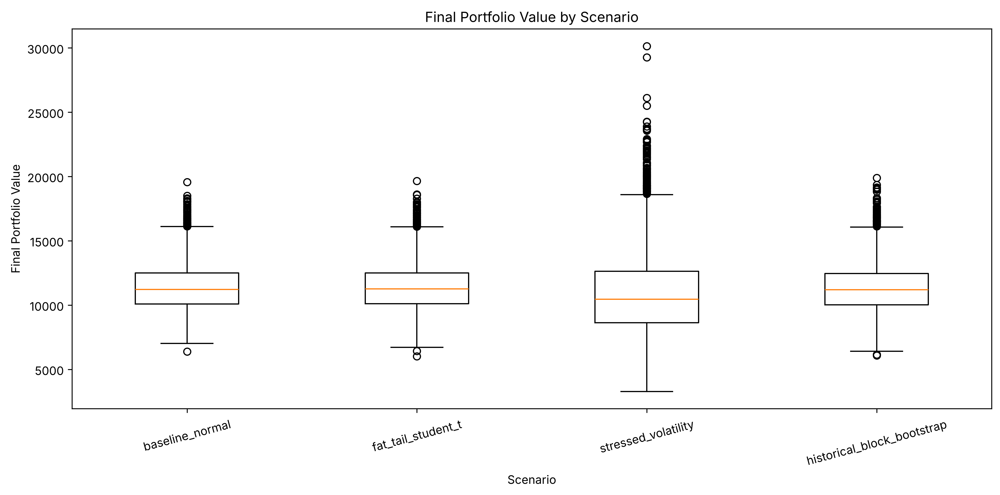
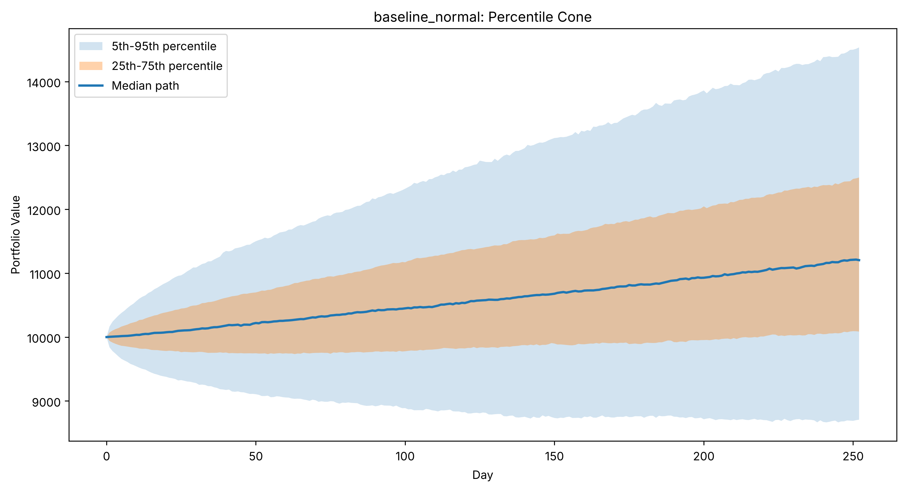
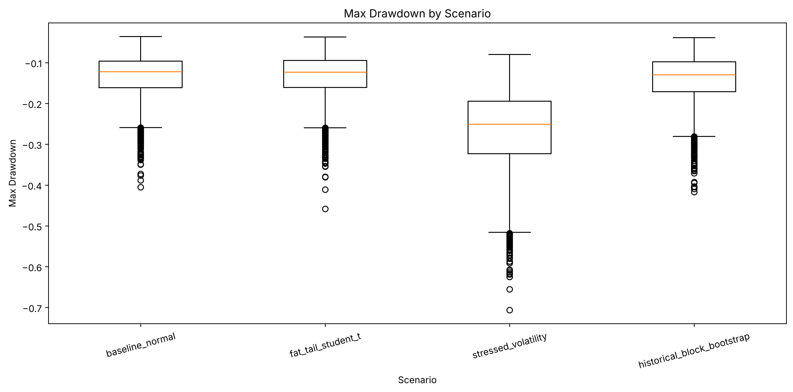

# Quant Risk Simulator


A Monte Carlo engine that simulates 5,000 one-year portfolio paths under four return models and compares
the resulting distributions of terminal value, drawdown, VaR, and CVaR.

A single backtest shows one path. This project asks how wide the range of plausible outcomes is, and how
much that range depends on the return model you assume.

---

## Scenarios

Each scenario simulates 5,000 paths × 252 trading days from $10,000, compounding daily returns
(vectorized with NumPy, one seed per scenario for reproducibility).

| Scenario | Daily return model |
|---|---|
| Baseline normal | Gaussian, mean 0.05%, std 1.0% |
| Fat-tailed Student-t | t with 5 degrees of freedom, rescaled to the same mean and std as the baseline |
| Stressed volatility | Gaussian, mean 0.03%, std 1.8% |
| Historical block bootstrap | 5-day blocks resampled from 1,254 daily SPY returns (2021 to 2026), preserving short-run autocorrelation and volatility clustering |

Because the Student-t scenario has the same variance as the baseline, any difference between the two comes
from tail shape alone.

---

## Results

| Scenario | Median return | P(loss) | 5% VaR | 5% CVaR | 1% VaR | 1% CVaR | Avg max DD | P(DD ≥ 20%) |
|---|---:|---:|---:|---:|---:|---:|---:|---:|
| Baseline normal | 12.0% | 23.2% | −12.9% | −17.9% | −20.9% | −24.5% | −13.4% | 10.8% |
| Student-t (df=5) | 12.6% | 23.0% | −13.1% | −18.1% | −20.7% | −25.3% | −13.3% | 10.2% |
| Stressed volatility | 4.6% | 43.9% | −34.9% | −41.8% | −46.3% | −51.1% | −26.6% | 72.7% |
| SPY block bootstrap | 12.0% | 24.7% | −13.7% | −19.5% | −23.7% | −28.3% | −14.0% | 14.0% |

VaR and CVaR are on one-year terminal return. In the stressed scenario 0.5% of paths lose more than half their value.



| | |
|---|---|
|  |  |

### What the numbers show

- **Fat daily tails barely move one-year risk.** At equal variance, the Student-t scenario's one-year 1% VaR
  (−20.7%) is essentially the baseline's (−20.9%). Summed over 252 independent days, fat-tailed daily
  returns average out toward a normal distribution (central limit theorem). The t-model only shows up in
  the far tail: worst drawdown −45.8% vs −40.5%, and a slightly deeper 1% CVaR.
- **Real data is riskier than either i.i.d. model.** The SPY bootstrap raises 1% VaR to −23.7% and the chance
  of a 20% drawdown from 10.8% to 14.0%, even with a similar median. Resampling 5-day blocks keeps the
  clustering of bad days that independent draws remove.
- **Volatility dominates.** Raising daily volatility from 1.0% to 1.8% more than doubles every tail measure and
  nearly doubles the probability of a loss, a far larger effect than changing the shape of the distribution.

---

## Running it

```bash
pip install -r requirements.txt
python main.py          # writes results/<scenario>/ and cross-scenario plots
pytest -q               # 17 tests
```

`data/historical_returns.csv` is built from the SPY data in
[quant-trading-backtester](https://github.com/kramarker/quant-trading-backtester) by `make_returns.py`.
If the file is missing, the bootstrap scenario is skipped.

Scenarios, path count, horizon, and seed live in [`src/config.py`](src/config.py).

## Tests

The suite in [`tests/`](tests) checks the return generators (shape, moments, seed reproducibility,
Student-t variance rescaling and excess kurtosis, bootstrap drawing only historical values in consecutive
blocks), equity compounding, max drawdown, VaR/CVaR, annualization, and that the configuration matches the
design described above.

## Project layout

```
src/
  config.py       scenarios and simulation settings
  returns.py      normal, Student-t, i.i.d. and block bootstrap generators
  simulator.py    vectorized equity curves and terminal returns
  metrics.py      path statistics, VaR/CVaR, drawdowns, scenario summaries
  plots.py        fan charts, percentile cones, histograms, boxplots
main.py
make_returns.py   builds historical_returns.csv from SPY prices
tests/
```

## Limitations

- Each scenario is a single asset with constant parameters; no time-varying volatility or regime changes.
- The bootstrap only knows the 2021 to 2026 SPY sample, so it cannot produce a crash larger than that window contains.
- Risk metrics are on one-year terminal values; no intra-year liquidity or margin effects.

## Possible extensions

- GARCH(1,1) scenario to model volatility clustering parametrically
- Regime-switching returns
- Multi-asset portfolios with correlated draws
- Feeding backtested strategy returns from the backtester into the bootstrap
